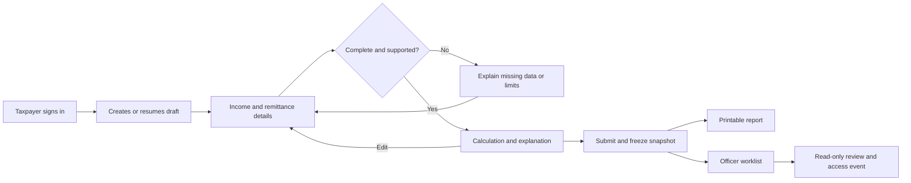
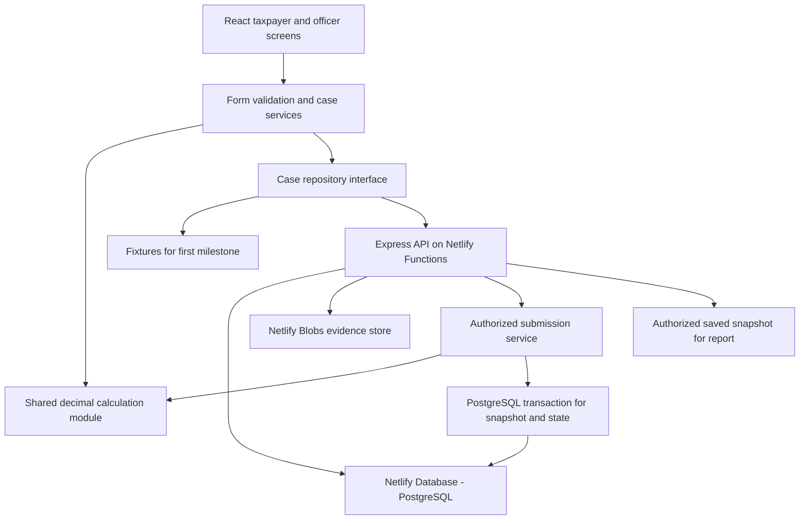

# Foreign Tax Credit prototype: product and implementation plan

Prepared 13 October 2026 from the supplied 21-page Group 5 presentation, with official-source research. Reviewed and revised 14 October 2026 for calculation, workflow and deployment gaps. Netlify hosting, Netlify Database and Netlify Blobs remain selected. This is a plan; no application, cloud database or deployment has been created. See the [review findings and remaining gates](.scratch/ftc-prototype/plan-review.md).

## 1. Selected direction

Build **one Thai-first web application with taxpayer and officer areas**. Its central demonstration is: enter foreign income and remittances, see an explained FTC calculation, save supporting evidence, submit the case to the prototype's queue, and inspect the same frozen result as an officer.

The user confirmed a working project/class demonstration with sample data and delegated the technology and scheduling choices. The planning baseline is **one developer, four weeks, approximately 80–120 focused hours**, with a working fixture-based demonstration at the end of week one. This is an estimate, not a supplied deadline or an assessment of the user's existing skills.

The target is **one Netlify-hosted application**, usable by taxpayer and officer accounts from different devices over HTTPS. Netlify now offers a managed PostgreSQL database, so use that native service for relational records. This replaces the earlier local SQLite plan. The hosted workflow requires internet access; retain a fixture-only local demonstration as a presentation fallback. [Netlify Database](https://docs.netlify.com/build/data-and-storage/netlify-database/).

| Decision | Selected baseline | Why |
|---|---|---|
| Product | One app, two role-based areas | The slides describe one shared case and calculation lifecycle |
| Interface | Thai first; English abbreviations where useful | Fits the source and intended users; full bilingual translation can wait |
| Frontend | React + TypeScript + Vite | Supports a responsive form-heavy application with a straightforward static build |
| Backend | Node.js + Express 5 + TypeScript, adapted with serverless-http to Netlify Functions | Keeps the planned API structure while running as serverless requests |
| Database | Netlify Database: managed PostgreSQL; @netlify/database and SQL migrations | Hosts users, cases, sessions and calculation history in the Netlify project |
| Login | Seeded app users; scrypt hashes; express-session with connect-pg-simple | PostgreSQL-backed sessions survive function instances and deploys |
| Documents | Netlify Blobs; authorized upload/download API; metadata in PostgreSQL | Stores evidence durably without relying on a function's local disk |
| Styling | Tailwind CSS; a small selection of shadcn/ui form/dialog/table components | Provides consistent controls while allowing Thai-specific labels and layout |
| Form validation | React Hook Form + Zod | Repeating income entries and clear field/case validation |
| Arithmetic | decimal.js in a shared, pure TypeScript calculation module | Explicit decimal precision and rounding; same logic in previews and submission |
| Tests | Vitest for calculations; Playwright for essential journeys; database/API permission checks | Tests the risky behavior without spending time on trivial UI internals |
| Report | Printable HTML with a print stylesheet | Produces a useful Save as PDF output without building a PDF service |
| Hosting target | Netlify static hosting for Vite dist output; same-origin /api routes to Functions | One HTTPS site for the frontend and backend |
| Data coverage | Frozen 2568/2025 educational scenarios, initially Vietnam and China | Makes the calculation explainable and testable within project scope |
| External services | Simulated e-Filing; fixed/manual source-labelled FX; curated rule fixtures | The PDF supplies no government integration contract or API credentials |

The updated [technology note](.scratch/ftc-prototype/research/technology-options.md) records current Netlify capabilities and deployment checks. Netlify documents [Express running through Functions](https://docs.netlify.com/build/frameworks/framework-setup-guides/express/) and a [database SDK with environment-aware connections](https://docs.netlify.com/build/data-and-storage/netlify-database/api/). Pin a supported Node runtime and compatible SDK versions during implementation; none has been installed or tested yet.

**Account prerequisite:** Netlify Database requires a credit-based plan and consumes usage credits. Its published limits include a Free tier, but this user's account eligibility and available credits have not been inspected. Current documentation still includes a storage promotion ending 1 July 2026, already past the planning date; do not assume storage remains free. Confirm the actual account's current charges, limits and backup retention before provisioning. No purchase or provisioning is part of this plan update. [Database billing and limits](https://docs.netlify.com/build/data-and-storage/netlify-database/billing-and-usage/).

## 2. What the first complete prototype must demonstrate

1. A fictional taxpayer opens a case for tax year 2568 and adds several income entries.
2. The form distinguishes income earned abroad, income brought into Thailand, and foreign tax paid.
3. The application explains proportional tax allocation and the country credit limitation with visible intermediate amounts.
4. The taxpayer saves a draft, attaches sample evidence, submits once, and opens a printable calculation record.
5. An officer signs in, finds the submitted case, inspects the original information and calculation, and leaves an access-history event without changing the taxpayer's figures.
6. An unsupported or incomplete case shows a specific explanation rather than a fabricated result.

Use a persistent label such as **“ระบบต้นแบบเพื่อการศึกษา”**. The submit action should say **“ส่งเข้าคิวตรวจสอบในระบบต้นแบบ”**. These explain the product boundary in the flow itself; they do not imply the case was filed with the Revenue Department.

## 3. Scope and deliberate limits

### Required for the four-week target

- Two fictional taxpayer accounts and one seeded officer account; separate entry screens backed by server-side password verification and PostgreSQL sessions. Public self-registration is outside the demo.
- Taxpayer dashboard: new case, draft/submitted status, tax year, last update, allowable FTC when calculated, and report access.
- Guided application form, repeatable income records, draft persistence, field validation, and explicit unsupported-case states.
- Dated FX reference values with quotation units and visible provenance. The first week may use THB reference rows before adding foreign-currency entry.
- Calculation breakdown, supported-scenario labels, and reproducible snapshots.
- Private sample evidence tied to an income/remittance record; PDF/JPEG/PNG, at most 3 MiB per file, one file per request and five files per record. This leaves headroom under the documented 4.5 MB effective binary request limit; test multipart overhead in a deployed Function. [Function payload limits](https://docs.netlify.com/build/functions/configuration/).
- Submission that freezes inputs, evidence, selected reference values and result.
- Officer worklist and read-only detail, restricted to assigned submitted cases.
- Print-friendly report and basic audit events.
- Seed/reset tools for fictional demo data; reset is limited to the dedicated demo environment.
- Reproducible Netlify build/deploy configuration, isolated preview data, database recovery and separate evidence-backup instructions; records and uploads survive redeploys.

### Add only after the required demonstration passes

- Search/filter improvements, copying a submitted case into a new draft, optional English text, CSV export, a richer FX-history display, and more individually reviewed example countries.
- Additional versioned historical FX fixtures after their rate-series selection and quotation units have been checked.

### Outside this prototype

Real e-Filing single sign-on or submission; tax payment; government identity verification; a complete PND90/91 tax engine; all treaties and income categories; OCR; AI tax advice; a rules administration console; officer approval/rejection workflows; email/SMS; commercial-scale operations; multi-year or repeated-remittance credit tracking; live tax/FX API integration; public account registration; offline synchronization. Netlify hosting, managed persistence and cross-device access are in scope for the prototype build.

The PDF's ten functional requirements are mapped to these choices in the [source review](.scratch/ftc-prototype/source-review.md). Central storage means the project's managed PostgreSQL database and durable evidence store. The Function API enforces role permissions; any week-one browser role switch is explicitly an interim simulation.

## 4. Screens and user journey

Retain the seven core screens from PDF pages 14–20, improving the long form into guided steps. Use a report route shared by both authorized roles.

| Screen | Suggested route | Main content and actions | Important states |
|---|---|---|---|
| Taxpayer entry | `/login` | Project identity, demonstration notice, seeded-account sign-in | Invalid login, loading, session expired |
| Taxpayer dashboard | `/app` | Create case; list own cases; continue draft; view result/report | Empty list, saved draft, submitted case, load failure |
| Application form | `/app/cases/:id/edit` | Five guided steps with repeatable income cards | Incomplete, unsupported scenario, save pending/failed, restored draft |
| Calculation preview | `/app/cases/:id/result` | Income totals, country table, line explanations, assumptions, submit | Ready, stale after input change, needs review, submitting, failed submission |
| Officer entry | `/officer/login` | Same auth system with a distinct officer layout | Wrong role, invalid login, expired session |
| Officer worklist | `/officer` | Assigned submitted cases; filter by year or case reference | Empty queue, submitted case, unauthorized case |
| Officer detail | `/officer/cases/:id` | Frozen inputs, evidence, calculation, audit events | Read-only, file unavailable, access denied |
| Printable report | `/reports/:snapshotId` | Case reference, tax year, inputs, steps, sources and total | Authorized view, missing snapshot, print layout |

**Form steps:** (1) tax year and supported-scenario check; (2) foreign-income sources; (3) remittances, FX and foreign-tax allocation; (4) Thai income and supplied Thai tax; (5) evidence and review. Save explicit drafts throughout; only show “saved” after persistence succeeds.

Draft saving accepts missing fields and unsupported scenarios, while checking the types and bounds of values that are present. Calculation requires complete supported arithmetic inputs; submission additionally requires current Thai-tax confirmation, evidence and a saved preview of the current revision. Keep these three validation levels separate. An empty field remains null rather than silently becoming zero. Preserve typed form values on failed saves/session expiry, offer reauthentication, and warn before leaving unsaved changes; hosted drafts must not be silently copied into the fixture fallback.

“Calculate” creates a server-validated preview snapshot from saved inputs. A draft report is clearly marked **“ร่าง — ยังไม่ได้ส่ง”**; after any edit, the old snapshot remains historical and cannot be submitted. The submission screen shows the exact supported assumptions and evidence checklist, then a case reference and submitted time on success. Reopening a submitted case always displays its frozen snapshot.



Use a white background, restrained blue accents drawn from the slides, readable Thai typography, text-labelled status badges, and tabular numerals for amounts. Bundle a Thai font locally for the offline demonstration. At narrow widths, use stacked income cards; avoid making the entire form horizontally scrollable. Labels, errors and keyboard focus must remain visible. Do not copy official seals, government login promises or official-receipt wording into the prototype.

## 5. Calculation scope and design

### Bounded educational policy

Use `rd-ftc-demo-2568-v1`: year 2568/2025, same-year earned income/remittance, Vietnam and China worksheet examples, salary under 40(1) and only the demonstrated dividend subtype of 40(4). Include one partial-remittance example. Keep one remittance per source in the initial supported flow; retaining separate records allows a later extension without pretending cumulative credit tracking already works.

Users supply domestic assessable income **J** and a known Thai tax amount **L** from a prepared example. Describe L as tax computed after expenses/allowances and before this FTC; show its source. Do not derive L from domestic income alone or present it as tax remaining after withholding. The complete tax-return calculation and all field mappings are outside v1.

Bind confirmation of L and its provenance to a server-computed fingerprint of all tax-relevant inputs, including J, sources, remittances and FX. An edit to those inputs clears confirmation and blocks a ready preview/submission until the user supplies or reconfirms the corresponding example tax. Evidence-only edits invalidate the preview revision but do not require a new L. Reconfirmation records an educational assumption; it does not prove the supplied tax is correct. Changing the seed fixture's income while retaining its L must never go unnoticed.

The official worksheet uses country/income-type input detail and a country summary. The prototype preserves that detail and demonstrates the published allocation sequence; it does not treat a treaty-country match as proof of legal eligibility. The rule findings and their limits are recorded in [tax research](.scratch/ftc-prototype/research/tax-rules.md), based in part on the [RD FTC manual](https://www.rd.go.th/fileadmin/user_upload/porphor/GuideTaxFromAbroad_TH.pdf).

### Input and conversion contract

- Store the selected year as 2025 and accept income/remittance dates within that year, with remittance on or after the income date. Residence days in the earned year must be an integer from 0 to 365; 180 enters the supported resident branch and 179 does not. Any unsupported source blocks a complete-case result; never drop it from K and calculate the remainder as if complete.
- F means the identified assessable-income portion remitted. It is not automatically the bank transfer total, principal, a gross-up of net proceeds, or an amount after fees. Mixed principal/income, ambiguous gross-versus-net facts, and tax refunds go to the unsupported explanation path.
- Support two explicit input modes per source: prepared THB worksheet amounts, or D/E/F in a single original currency using one common positive THB rate and quotation unit. In the second mode, use `THB = originalAmount × rate / baseUnits` for all three values and preserve the original share F/D. Do not convert D using an earned-date rate and F using a different remittance-date rate. Cross-currency and separately dated conversions are outside this version.
- A conversion reference records a bank buying rate on the remittance date or an attributed preceding-business-day BOT average buying rate; the manual's D and F examples use the remittance basis. Preload checked dates/rates for supported fixtures. A manual reference requires a rate date, type, source and explicit educational assumption; missing weekends/holiday coverage is not filled by subtracting one calendar day. This restricted common-rate policy is a prototype choice, not a universal tax-conversion rule. [RD manual, printed pp. 10–11](https://www.rd.go.th/fileadmin/user_upload/porphor/GuideTaxFromAbroad_TH.pdf#page=13).
- Keep actual foreign tax paid and the assumed eligible E separately. Seed E from the prepared example; an edited case explicitly supplies/confirms E and its rationale with `0 ≤ E ≤ actual tax paid`. Neither the country selector nor the server invents treaty eligibility. Display “credit under stated demo assumptions” beside the result.
- Input monetary amounts use at most two decimal places, from 0 to 999,999,999.99; rates use at most eight decimals and must be positive and at most 1,000,000; quotation units are 1 or 100. These are demo limits. PostgreSQL NUMERIC(30,12) stores monetary/converted inputs and NUMERIC(18,8) stores rates; derived ratios/tax results remain unrounded decimal strings in snapshots. The input/rate/unit bounds fit these columns exactly; reject out-of-contract inputs instead of silently truncating. The calculator uses 40 significant digits internally.

An empty case can be saved. A zero-remittance case displays a zero-contribution explanation and remains a draft; submission requires at least one supported source with F > 0. A supported case with L = 0 can still submit a zero-credit result with its explanation.

### Processing sequence

1. Validate year, dates, currency units, residence-year facts, supported country/type, completeness, and nonnegative amounts. Unknown classifications produce “needs review,” not zero credit.
2. Convert each relevant source amount to THB with its explicit reference rate and units; retain original values and provenance.
3. For the supported worksheet scenario, determine remittance share and attributable foreign tax from the same stated monetary basis.
4. Aggregate remitted assessable income and attributable tax by country, retaining each source/type contribution.
5. Compute the country limitation using the supplied Thai tax and total assessable income; take the lesser eligible tax/limitation.
6. Return a structured explanation, assumptions, validation messages, country results, total and reference versions.
7. Save a calculation snapshot. The authenticated submission Function recomputes from persisted PostgreSQL inputs before committing the final submitted snapshot.

Illustrative worksheet notation:

```text
D = total relevant foreign income in THB
E = foreign tax allocated to that income
F = relevant assessable income remitted in THB
G = (F / D) × E
I = sum of F
J = domestic assessable income before expenses/allowances
K = I + J
L = supplied Thai tax computed after expenses/allowances, before this FTC

For each country:
N = sum of F in that country
O = sum of G in that country
P = (N / K) × L
Q = min(O, P)
Demonstrated total FTC = sum of Q
```

The formula assumes the tax supplied for this demonstration is eligible. Preserve actual foreign tax paid separately from any treaty-eligible amount; v1 must not invent a general treaty adjustment. A real-use extension needs article-specific review, especially for dividends and tax withheld above treaty limits.

### Source example discrepancy

For the slide's `K=1,975,000` and `L=318,750`:

| Country | Remitted income | Attributable foreign tax | Recomputed Thai limit | Demonstrated credit |
|---|---:|---:|---:|---:|
| Vietnam | 750,000.00 | 225,000.00 | 121,044.30 | 121,044.30 |
| China | 225,000.00 | 22,500.00 | 36,313.29 | 22,500.00 |
| Total | 975,000.00 | 247,500.00 | 157,357.59 | **143,544.30** |

The slide displays **143,554.30**; it must not become an unquestioned expected test value. This table independently recomputes the displayed formula, not the legal validity of the inputs. The official manual also contains inconsistent example totals. Keep the source value, recomputed value, and discrepancy note in the fixture documentation.

For an additional allocation fixture, `D=50,000`, `E=5,000`, `F=25,000` gives a 50% share and `G=2,500`. This original-income/remittance distinction is absent from the slide's simplified THB input screen and should be visible in the prototype.

### Precision and failure behavior

- Use decimal.js values constructed from strings with adequate intermediate precision. Store amounts/rates in PostgreSQL NUMERIC columns with validated bounds, and preserve decimal strings across the API and JSON snapshots. Never coerce database decimals to JavaScript Number before calculation; verify driver round trips and rounding boundaries in tests.
- Prototype convention: preserve intermediate precision and round the sum of unrounded country Q values half-up to two decimals once. Round each country only for display; show a separate display-rounding reconciliation equal to `final total − sum(displayed country credits)` when nonzero. This keeps the final credit at or below the two-decimal L while reconciling the visible table. Store the rounding policy and adjustment in snapshots. This replaces the earlier sum-of-rounded-countries convention; legal rounding has not been established.
- Regression example: two countries with N=1 each, K=2, L=0.01 and sufficient foreign tax each yield Q=0.005. Displayed country rows are 0.01 each, reconciliation is −0.01, and final credit is 0.01. Do not display 0.02 as the total.
- Reject negative amounts, inconsistent currency units, `F>D` within the supported single-source model, invalid dates, and zero income denominators. A legitimate empty/no-remittance case has a separate zero-contribution explanation.
- An input edit invalidates the prior preview. A failed hosted API request or missing FX fixture shows an error and never substitutes today's rate or a made-up value.
- Unsupported tax years, cross-year remittances, repeated remittances, nonresident-earned income, unknown treaty treatment and special exemptions do not produce a normal “ready to submit” result.

## 6. Data model

The slide ER model is a useful starting point. Replace ambiguous fields and preserve historical calculations before building forms around it.

| Record | Essential information | Relationship / rule |
|---|---|---|
| App user | User ID, login name, salted scrypt password hash and parameters, role | Seeded accounts; server controls roles; hashes never returned to browser |
| Profile | App user ID, fictional display name, masked demo reference | Separate taxpayer information from login credentials |
| Session | Opaque session ID, user reference, expiry and session data | PostgreSQL-backed express-session store; logout invalidates the session |
| Protected role/assignment | Officer membership and case scope | User cannot grant themselves officer access |
| FTC case | Owner, Gregorian tax year, draft/submitted state, J, L, L provenance and confirmed-input fingerprint, revision, assigned officer, submitted snapshot, timestamps | Taxpayer has many cases; draft may have missing inputs and no calculation |
| Foreign-income source | Case, country, income type/subtype, earned year/date, residence days, input mode, gross amount/currency, actual tax, assumed eligible E and rationale | Case has at most 20 sources; unsupported sources remain visible |
| Remittance | Source, date, amount/currency, FX references and THB values | Distinct from earned income; v1 supports one per source |
| Attachment | Source/remittance, environment/store and generated key, display name, MIME type, size, digest, upload status/time | File bytes in Netlify Blobs; metadata authorizes access and identifies exact evidence |
| FX reference | Currency, THB quote, base units, effective date, source, rate type, manual/fixture marker | Exact consumed values retained in calculation snapshot |
| Rule set | Identifier, tax year, supported cases, source URLs, effective dates, review date, assumptions, rounding policy | Versioned; historical versions preserved |
| Calculation snapshot | Case revision, draft/submitted kind, immutable inputs/results, line and country breakdown, display-rounding reconciliation, rule/FX versions, engine version, timestamp | One case can have many snapshots; one is submitted; draft reports are marked |
| Audit event | Actor, case/snapshot, event type and server time | Append-only through authorized operations; not a report row |

For this small prototype, keep the complete calculation breakdown as validated PostgreSQL JSONB alongside relational source records; a separate table for every result cell is unnecessary. Encode decimal values as strings in snapshots and API responses. Each snapshot contains the values it used, not just mutable foreign keys.

Use PostgreSQL DATE for business dates and TIMESTAMPTZ for events, exchanging ISO date/time values through the API. Store tax year as integer 2025 and display 2568 consistently. Keep explicit currency codes, foreign keys and parameterized queries. Replace `DomesticTax_L` with `thai_tax_before_ftc`, and `ImportDate` with `remittance_date`. Version schema changes under `netlify/database/migrations/` using Netlify's documented migration workflow. [Database migrations](https://docs.netlify.com/build/data-and-storage/netlify-database/migrations/).

Enforce unique remittance per source, unique submitted snapshot per case, valid state/role enums, nonnegative present amounts and same-case child references. Use restrictive deletion for submitted records. Draft nullable columns must remain compatible with incomplete saves. Index case owner/update time, assigned officer/status/submission time, child foreign keys and session expiry. Generate opaque case/file IDs server-side; treat IDs as locators, never access grants.

## 7. Architecture, state and access



Separate `calculateFTC(inputs, policy)` from React, network access and storage. It returns results and explanation steps rather than formatted HTML. Use one implementation in browser and server builds, with contract tests ensuring matching outputs.

Suggested project organization when implementation begins:

```text
src/
  app/                 routes and role layouts
  features/cases/      dashboard and form
  features/review/     officer queue and detail
  features/reports/    snapshot report and print styles
  components/          shared accessible controls
  data/                fixture and hosted HTTP repositories
  fixtures/            fictional cases and references
shared/
  tax/                 calculator, validation, rule types and tests
server/
  app.ts               Express app exported without a listening socket
  routes/              REST API and authorized evidence downloads
  middleware/          sessions, role checks, request validation
  services/            cases, submission, evidence, audit operations
  db/                  Netlify Database SDK and parameterized repositories
  storage/             Netlify Blobs access and environment isolation
  scripts/             controlled seed/reset and evidence export helpers
netlify/
  functions/api.ts     serverless-http entry point and SDK context
  database/migrations/ versioned PostgreSQL schema and state protections
netlify.toml           build, publish directory, API routing and SPA fallback
tests/
  e2e/                 essential browser journeys
  permissions/         allow/deny and frozen-state checks
```

The only case-state transition in v1 is **Draft → Submitted**. Reviewing adds a view event and optional last-viewed time; it does not create an Approved state. Editing a submitted case is forbidden. A later copy-as-new-draft feature may preserve the original through a link, without reopening it.

For v1, submission assigns every case to the one configured active seeded officer in the same transaction as the snapshot. The client cannot choose that officer. If the configured account is missing/inactive/not an officer, submission fails without changing the draft. Drafts have no officer access; reassignment and an assignment administration screen are outside v1. An additional test-only officer verifies denial for unassigned cases.

| Operation | Taxpayer | Assigned officer |
|---|---|---|
| Read own draft | Yes | No |
| Edit own draft and evidence | Yes | No |
| Submit owned complete case | Yes, through controlled server operation | No |
| Read submitted case and evidence | Own cases | Assigned cases |
| Edit submitted figures or files | No | No |
| View/print submitted report | Own cases | Assigned cases |
| Record a review access event | Not as an officer | Through controlled review access |

Enforce ownership, assigned-officer scope and draft-only mutations in Express services for every case, child record, report and file request. Database and Blob credentials remain in Functions; the browser has no direct storage access. Constraints and triggers protect state invariants, but do not replace caller authorization. Netlify team/dashboard permissions are separate from the prototype's taxpayer/officer roles. [Netlify database access control](https://docs.netlify.com/build/data-and-storage/netlify-database/access-control/).

Use express-session with `connect-pg-simple`, seeded application users and salted scrypt password hashes. Persist sessions in PostgreSQL with the environment's SDK pool; never use MemoryStore. Set Secure, HttpOnly, host-only and SameSite cookies for hosted HTTPS; regenerate on login and invalidate on logout. Validate allowed origins and protect mutations against CSRF. Keep the signing secret in Function-scoped environment variables, separate by deployment context; exclude credentials from VITE_ variables and frontend assets. Add persistent login-attempt limits and disable open registration. Session expiry must be enforced on every lookup; cleanup must not depend on timers surviving a function invocation. [PostgreSQL session store](https://github.com/voxpelli/node-connect-pg-simple).

Verify trusted-proxy/HTTPS detection through the deployed Express adapter; otherwise Secure cookies may never be issued. Do not blindly trust client-supplied forwarding headers. Set `saveUninitialized: false`, `resave: false`, SameSite=Lax and Path=/; persist the regenerated login session before returning success. Use a 30-minute idle limit and eight-hour absolute limit enforced server-side. Clear browser query/form caches on logout/account changes, and scope cached records by authenticated user. HTTP development has a separate local-only cookie configuration. [Express session configuration](https://expressjs.com/en/resources/middleware/session/), [trusted proxy guidance](https://expressjs.com/en/guide/behind-proxies/).

On submission, acquire one pooled connection and use a short PostgreSQL transaction. Verify the owner, lock the case row, check draft state and expected revision, load its inputs, recompute, and persist the snapshot, submitted pointer and audit event together. Every child mutation must lock the same case and advance its revision. Reject stale edits; valid retries return the existing submission. Keep Blob/network I/O outside the transaction, roll back failures and release the connection in finally. Do not issue BEGIN/COMMIT through unrelated pooled queries. [Netlify Database transaction API](https://docs.netlify.com/build/data-and-storage/netlify-database/api/).

Use Netlify Blobs for evidence bytes and PostgreSQL for access metadata. Production evidence uses a durable site-wide store with generated keys, authorized downloads and strong reads where immediate visibility matters. Never accept arbitrary store/key selection from the browser. Responses for cases, sessions and evidence use private/no-store caching. The application is responsible for caller permissions. [Netlify Blobs](https://docs.netlify.com/build/data-and-storage/netlify-blobs/).

Reserve an upload intent after authorization, write the object, then recheck case state under the case-row lock before marking evidence ready. A failed finalization leaves an orphan for safe cleanup, not a late attachment to a submitted case. Freeze selected evidence keys and digests in the submission. Draft deletion removes the authorized metadata link before object cleanup; never overwrite or delete submitted evidence. PostgreSQL and Blobs do not form a single atomic transaction.

Validate file signature as well as declared MIME/extension, reject empty files, sanitize display names, and return downloads with attachment disposition and nosniff. Downloading sample PDFs is sufficient; embedded PDF rendering is optional. Permit 20 sources, 20 attachments and 30 MiB per case, with the existing five-file/source and 3 MiB/file limits, and ten cases per taxpayer. Reserve quota under the case lock, counting pending uploads too. This bounds the controlled demo's storage; it is not an antivirus claim.

For each source with F > 0, require at least one ready fictional evidence file and a checklist covering income, remittance and foreign tax if E > 0; one combined sample file may cover multiple items. Submission rejects pending/failed uploads and missing checklist items. Abandoned uploads must be canceled or completed explicitly. A developer-run, environment-scoped cleanup command handles expired intents/orphans after checking they are not referenced; no public cleanup/reset endpoint and no in-memory scheduled jobs. Evidence-only edits still advance the case revision.

### API and failure contract

| Endpoint family | Required behavior |
|---|---|
| POST `/api/auth/login`, POST `/api/auth/logout`, GET `/api/auth/session` | Establish, revoke and restore server-side identity; never accept a client role |
| GET/POST `/api/cases`, GET `/api/cases/:id` | Owner-scoped list/create/read; retry-safe creation with an owner-scoped request ID |
| PUT `/api/cases/:id/draft` | Save the input aggregate transactionally with expected revision; partial completeness allowed; no file-byte replacement |
| POST `/api/cases/:id/attachments`, DELETE `/api/attachments/:id`, GET `/api/attachments/:id` | Authorized upload/removal/download using generated storage keys |
| POST `/api/cases/:id/calculate` | Calculate saved inputs and save a draft snapshot only if its revision still matches |
| POST `/api/cases/:id/submit` | Require expected revision, preview ID and request ID; revalidate/recompute and assign officer atomically; unique submission per case |
| GET `/api/officer/cases`, GET `/api/officer/cases/:id`, GET `/api/snapshots/:id` | Assigned submitted access for officer; owner access to own snapshots; record officer detail/file/report access |

Validate requests and responses with shared schemas. Use structured errors with code, Thai message, optional field paths and request ID: 401 unauthenticated, 403 forbidden role, 404 missing/inaccessible object, 409 stale revision/state, 413 oversized, 415 unsupported media, 422 invalid/incomplete/unsupported, 429 rate limited, and 503 transient storage/service failure. A 409 reloads the latest saved revision and offers a deliberate reapply; it never silently overwrites. The server selects rule/FX records, verifies manual references and computes all derived values; browser totals are ignored.

A submission retry that matches an already committed request returns its original result even if the first response was lost; a conflicting request does not overwrite it. After an ambiguous network timeout, fetch case status before retrying. Preview-to-submit rule/engine changes require a refreshed preview, rather than silently submitting a different result. Log only request ID, operation, duration, status and internal identifiers; omit passwords, cookies, financial request bodies and file bytes. Record officer access before returning protected data; if the audit write fails, return an error rather than pretending access was logged.

### Hosting, environments and recovery

- **Build/deploy:** use `npm run build`, publish `dist`, and package `netlify/functions`. Configure /api rewrites before the SPA fallback; unknown API paths return API errors, not index.html. Export the Express app through serverless-http without app.listen. Verify SDK initialization and binary responses through this wrapper in the first deployed integration test.
- **Repository/checks:** use a Git repository linked to Netlify with one production branch and short-lived trusted preview branches. Run locked dependency install, TypeScript checking, calculation/API tests and Vite build before publication; run deployed smoke tests before selecting the production candidate. Keep migrations additive/backward compatible because old code can briefly share the new schema. Seed separately with an idempotent developer command; never reset data or rotate passwords on every deploy.
- **Persistence:** Functions are ephemeral, so no SQLite file, local upload directory or process-memory session is authoritative. Durable records live in Database and documents in Blobs. [Function runtime](https://docs.netlify.com/build/functions/overview/).
- **Development:** use Netlify Dev's PostgreSQL-compatible local environment, with local migrations and fictional seeds; use its sandboxed Blob store. Do not maintain a separate SQLite schema. Keep the basic fixture demo available independently. [Database local development](https://docs.netlify.com/build/data-and-storage/netlify-database/local-development/).
- **Database previews:** let the SDK select the correct database branch. Do not hardcode a production connection URL into previews. Preview copies may include seeded users/sessions; invalidate copied sessions and use context-specific secrets.
- **Evidence previews:** Blob stores do not automatically mirror database branching. Select separate preview store namespaces on the server, seed fictional preview documents, and reject copied production evidence references. Tie a preview namespace to its verified database-branch lifecycle so redeploying that preview does not lose its evidence; do not choose a fresh namespace per request or build. Before allowing authenticated use of a new preview branch, run a one-time scoped fixture initialization that invalidates copied sessions and replaces cloned demo data/references consistently; never reset an existing preview on every deploy. Production evidence uses a stable store across redeploys. Namespaces isolate application behavior, not malicious code with site credentials; only trusted project changes receive backend access.
- **Regions:** select supported Function/database regions together, and configure the Blob store's region explicitly and consistently. Confirm actual account options during setup; do not assume a default region meets an unstated residency requirement.
- **Recovery:** document available database snapshots and retention, plus separate evidence exports/manifests. A code rollback does not automatically restore the database; a database restore does not restore Blob objects. Rehearse a coordinated recovery in a disposable test environment, invalidate restored sessions, and verify every evidence reference. [Backup behavior](https://docs.netlify.com/build/data-and-storage/netlify-database/backup-and-recovery/).
- **Access and cost:** confirm team ownership, credit-based Database eligibility, usage notifications and available limits before provisioning. Use fictional data only. Keep sleep-on-inactivity enabled for the prototype and measure cold-start behavior; never promise a free always-on service.
- **Presentation:** use the hosted HTTPS site from separate browser profiles or devices. If internet fails, the fixture fallback demonstrates UI/calculations only; it does not claim access to the live queue or latest hosted records.
- **Operations:** distribute generated demo credentials privately to the class/presenter, exclude them from Git/frontend fixtures, and rotate them after the demonstration. Document owner, exact demo environment and a dry-run manifest for reset/cleanup. Retain submitted examples for the assessment period; any later whole-demo reset is an explicit operator action with a backup, not a user-edit feature or automatic deploy step. Display the release/policy identifier and a useful request ID on failures; keep a short rollback/recovery and cold-start troubleshooting note.

### Deployment sequence when implementation begins

1. Initialize the implementation repository and lock dependencies. Allocate the first 4–6 implementation hours to account checks and the minimal hosted integration in the next step; build the fixture milestone alongside this gate.
2. Link a Netlify project and trusted Git workflow, confirm account requirements, add build/routing configuration and provision the minimal test database/schema. Prove database read/write, a Secure session round trip and a small Blob upload/download. If the integration gate fails, resolve it before committing the rest of the UI to the hosted design; the fixture workflow can still progress.
3. Use versioned database migrations, Function secrets and controlled fictional accounts. Run idempotent seeds only after the target schema exists. No real taxpayer data is imported.
4. Integrate the production evidence store and isolated preview stores; validate the 3 MiB upload policy and download authorization.
5. Test a deploy preview's calculation, session, persistence and isolation behavior, then publish the tested production build.
6. Repeat the full workflow after a redeploy and a cold start; record the URL, recovery procedure and observed usage. No step has been executed in this planning update.

## 8. Four-week delivery sequence

The estimates below total **80–120 hours** and include iteration. A developer new to React, SQL and authorization may need more time. Keep the first complete workflow small before adding visual polish.

| Milestone | Estimate | Build sequence | Exit condition |
|---|---:|---|---|
| Week 1: integration gate and calculation demo | 24–34 h | Account/Function/Database/session/Blob spike (4–6 h within this estimate); scaffold; Thai UI; calculator and fixtures; form, preview and print | Hosted integration gate passes; fictional taxpayer completes calculation/print, including partial remittance, rounding and unsupported cases |
| Week 2: hosted drafts and evidence | 22–32 h | Finish migrations and seeded users; persistent sessions; owner-scoped draft API; Blobs quotas/checklist; deploy preview | Two accounts save independently; incomplete drafts reload; unauthorized access fails; records/files survive cold starts/redeploy |
| Week 3: complete review workflow | 18–26 h | Authoritative submission; officer assignment; freeze enforcement; worklist/detail; audit events; final report | Taxpayer submits, assigned officer sees the same result, and direct attempts to edit submitted case/evidence fail |
| Week 4: verification and presentation | 16–28 h | Permission/race tests; preview isolation; Thai/mobile/print review; recovery rehearsal; production publication and usage review | Hosted workflow works across devices; preview cannot alter production cases/evidence; recovery and fixture fallback are documented |

Dependencies matter: stabilize input meanings before calculation tests; establish the snapshot shape before reporting; establish ownership and freeze behavior before exposing the officer queue. Netlify account access is needed for the hosted milestone; live government/FX integration is not on the critical path.

If only one or two weeks later become available, deliver the fixture calculation, role simulation and printable report, and identify any missing hosted authentication/persistence. Browser storage does not meet shared backend requirements. If the build runs late, cut extra countries and optional features before cutting arithmetic, access or preview-isolation checks.

When two contributors become available, split UI/report work from calculation/data/access work after agreeing on the shared case and snapshot contracts. Additional people are not assumed in the baseline.

## 9. Acceptance and demonstration

### Meaningful calculation checks

| Scenario | Expected result |
|---|---|
| Displayed slide formula | Recomputed total 143,544.30; source discrepancy recorded |
| Partial remittance D=50,000, E=5,000, F=25,000 | Allocated tax 2,500; share 50% |
| N=100,000, K=200,000, L=20,000, O=5,000 | Limit 10,000; allowed credit 5,000 |
| Same inputs with O=15,000 | Allowed credit 10,000 |
| Two countries | Each country capped before summation; no pooling of unused foreign tax |
| Two types in one country | Details preserved and country summary reconciles |
| L=0 | Zero credit capacity with explanation |
| D=0, invalid date, negative input, F>D | Actionable validation; no NaN or silent correction |
| Currency quotation per 100 units | Conversion uses declared units, not an assumed one-unit quote |
| Full remittance with a common rate | F/D remains 100%; a separate earned-date rate cannot introduce a false F>D error |
| Two country credits of 0.005, L=0.01 | Final 0.01; displayed 0.01+0.01 reconciled by −0.01 |
| Change income/FX after confirming L | Ready preview/submission blocked until matching L is reconfirmed |
| Residence days 179 and 180; mixed supported/unsupported sources | Correct supported boundary; unsupported source blocks the whole-case result |
| Missing amount versus explicit zero | Draft saves null; calculation reports missing field rather than treating it as zero |
| Exact bounds and one step beyond | Declared money/rate/row limits enforced; decimal database round trip is exact |
| Unsupported year/type/residence/remittance facts | Explicit unsupported state; no normal submission result |
| Change rule or FX fixture after submission | Existing snapshot/report stays unchanged |

Use independent worked arithmetic to establish expected values. Do not merely run the same implementation twice and call it validation. Arithmetic tests do not certify treaty eligibility.

### Workflow and permission checks

- Create, save, reload, edit and calculate a draft without losing income rows or attachment links.
- Taxpayer A cannot read or modify taxpayer B's data or documents, including by changing an ID in a URL or API request.
- Anonymous access fails; protected role membership cannot be self-assigned.
- Officer reads only assigned submitted cases and cannot change values through either UI or direct requests.
- Submission uses the server result, resists browser-total tampering, and does not duplicate on retry.
- A simultaneous edit/submit yields a safe revision conflict instead of freezing mixed inputs.
- Submitted inputs, snapshot amounts and file objects cannot be replaced or deleted through normal app access.
- The report and officer detail match the same snapshot; review access records the authenticated actor and server time.
- Failed saves/uploads remain visible and recoverable; no fake success states.
- Redeploy and exercise a cold Function instance: cases, sessions and attachments remain usable.
- Restore a disposable test database/evidence backup and verify every referenced object and digest; code rollback alone must not be mistaken for data recovery.
- A deploy preview uses its own database branch and evidence namespace; writes/deletes never mutate production records or files.
- Test allowed and oversized binary uploads through the deployed wrapper; reject unsupported file types and arbitrary object-key requests.
- Use a second device/browser profile to verify hosted persistence and role checks; disconnect the network to verify honest failure states and the separate fixture fallback.
- Verify HTTPS session cookies, CSRF/origin checks, login-attempt limits, logout/expiry, and no shared-cache leakage of reports or evidence.
- Verify automatic officer assignment, and fail submission without state changes if the configured officer is unavailable; a test-only unassigned officer has no access.
- Reject pending/missing required evidence; exercise signature mismatch, per-file and aggregate quotas, and upload finalization racing with submission.
- Lose a submit response after commit and retry; receive one original snapshot. Recalculate on rule/engine mismatch rather than silently replacing the preview result.
- Log out taxpayer A, log in taxpayer B in the same browser, and verify no previous account data survives in rendered or cached state.
- Repeat an idempotent seed and redeploy without resetting cases/passwords; a failed migration must not publish an incompatible build. Exercise a database outage as a visible recoverable failure.

### User-facing quality checks

Try the application at desktop and phone widths, entirely with the keyboard, and with Thai text and long file names. Print to PDF and verify Thai glyphs, page breaks, clipped tables, totals and source labels. Define prototype targets of a near-instant calculation for a 20-row case and useful loading feedback for network operations; measure them on the presentation device rather than making a production performance claim.

### Five-minute presentation script

1. Introduce the foreign-income problem and the two roles.
2. Open a seeded draft and explain earned income versus remitted income using the 50% example.
3. Calculate, open a country breakdown, and show why one country's credit is limited.
4. Show one deliberate validation error, correct it, attach a sample document and submit.
5. Sign in as the officer, review the unchanged result, and open the report/audit trail.
6. Explain the source arithmetic discrepancy, the bounded tax assumptions, and how Netlify hosts the app, PostgreSQL records and evidence.

## 10. Delivery package and risks

The eventual handover should contain source and lockfile, a supported Node runtime, netlify.toml, Function code, PostgreSQL migrations, fictional seeds, reference provenance, test results, a sample report, deployment URL, setup instructions, environment-variable names without values, preview-isolation rules, and coordinated database/evidence recovery instructions. Include account prerequisites and an observed usage check; package the fixture fallback for presentation failures.

| Risk or unknown | Planned response |
|---|---|
| Source numerical errors or unclear tax definitions | Document discrepancies; keep independent arithmetic fixtures and explicit J/K/L meanings |
| Treaty exceptions beyond the sample | Scope country/type cases narrowly; show eligibility assumptions and unsupported paths |
| Government or BOT integration unavailable | Use local fixtures/manual references; live APIs are outside the selected version |
| Internet unavailable during presentation | Use the separately labelled fixture fallback; never imply the hosted queue is available offline |
| Backend work exceeds schedule | Preserve the week-one demo, cut optional features, and accurately label any reduced final scope |
| Hosted cases or files exposed | Use fictional data, authorized Function routes, protected secrets and private/no-store responses |
| Preview modifies production evidence | Separate Blob namespaces and validate environment on every evidence operation |
| Concurrent writes or partial object upload | Case-row locks, revisions, idempotent submission and tracked upload intents |
| Database restores but evidence is missing | Keep coordinated object manifests/exports and test recovery independently of code rollback |
| Account limits, cold starts or unavailable Database entitlement | Check credit-based account setup early, measure usage/latency, and resolve plan eligibility before promising a live demo |
| New rules or different tax year | Add a new versioned policy only after review; never update saved snapshots in place |

The target requires a Netlify account with Database eligibility. A default Netlify site domain is sufficient for the prototype; a custom domain is optional. Costs depend on the account and usage. If this account cannot enable Netlify Database, stop database provisioning and revisit the account plan or a separately agreed managed PostgreSQL provider; do not substitute a SQLite file in a Function. No account settings, paid services or deployments were changed in this planning update.

## 11. Wayfinder handoff

The [decision map](.scratch/ftc-prototype/map.md) is the canonical tracker index. The architecture ticket records the latest Netlify hosting request and verified native PostgreSQL support. Remaining tickets organize screen and behavior validation; the earlier local-only choice is superseded.

The next implementation milestone is the **week-one integration gate plus fixture-based taxpayer flow and calculation explanation**. Week two completes hosted drafts and evidence; week three completes the officer workflow. The [14 October review](.scratch/ftc-prototype/plan-review.md) records the tightened contracts and outstanding implementation checks. Open interaction tickets remain validation tasks; no new user approval is required to begin the delegated baseline when implementation is requested.

Supporting material: [source traceability and corrections](.scratch/ftc-prototype/source-review.md), [tax-rule research](.scratch/ftc-prototype/research/tax-rules.md), [technology comparison](.scratch/ftc-prototype/research/technology-options.md), and [domain glossary](GLOSSARY.md).
